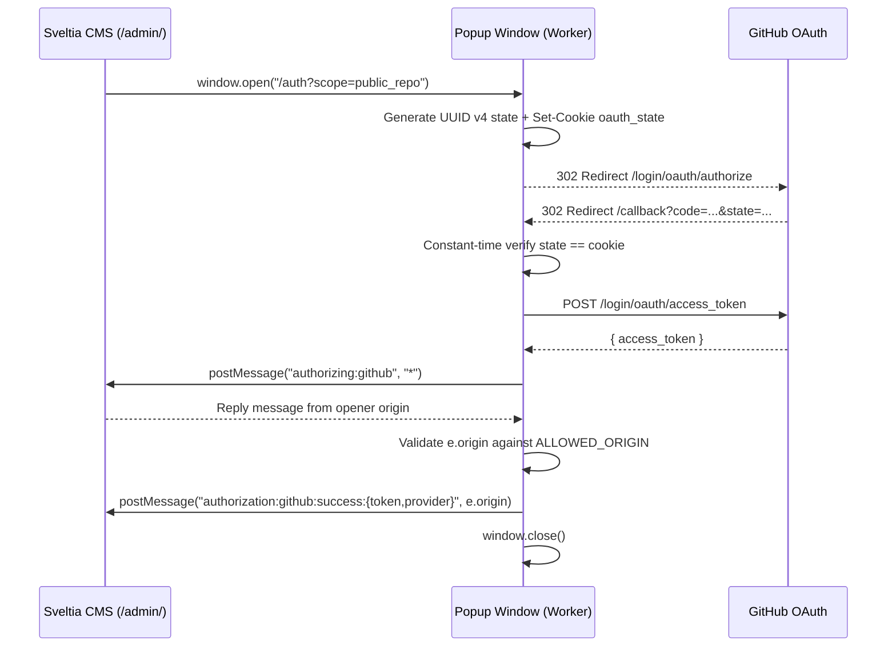

# OAuth 2.0 & Sveltia CMS Handshake Protocol

Sveltia CMS (and Decap CMS) uses a browser popup flow to authenticate with GitHub without exposing `GITHUB_CLIENT_SECRET` in client-side code.

## Sequence Flow

## Security Controls

1. **CSRF State Cookie**: `/auth` generates a random UUID v4 `state` and stores it in `oauth_state` with `HttpOnly; Secure; SameSite=Lax; Path=/callback; Max-Age=300`. `/callback` compares query `state` against the cookie in constant time and clears the cookie immediately.
2. **Origin Validation**: The callback HTML script verifies `e.origin` matches `ALLOWED_ORIGIN` (or `.github.io`) before transmitting the token via `window.opener.postMessage`.
3. **Script Injection Escaping**: Serialized JSON payloads escape `\`, `'`, `<`, and `>` before embedding into the inline JavaScript template.
